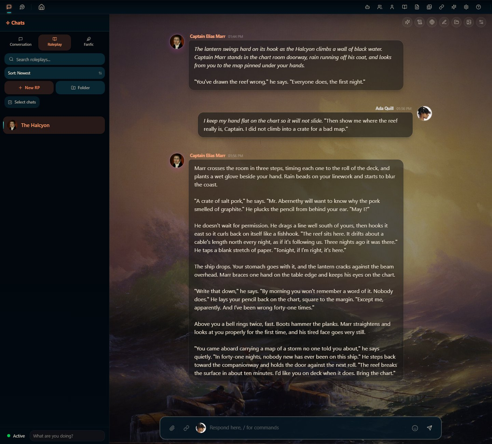
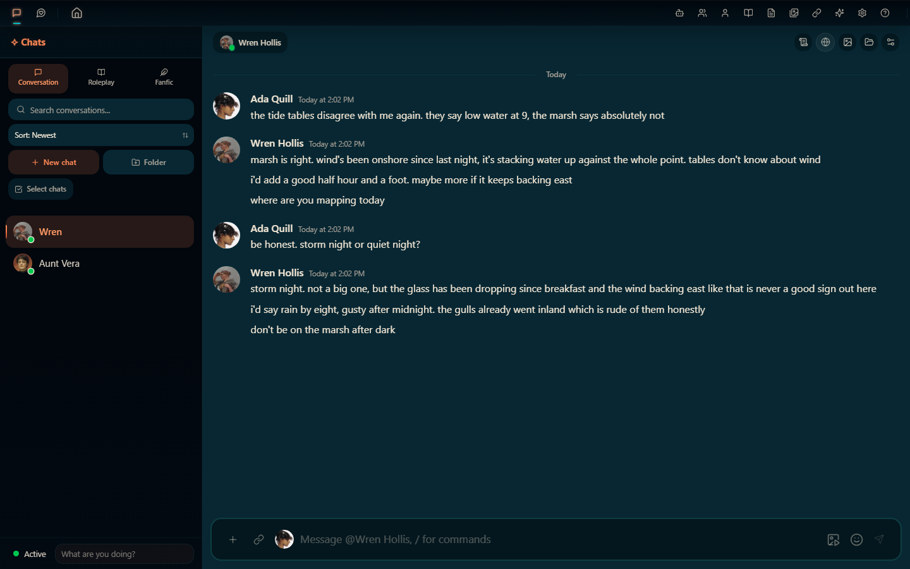
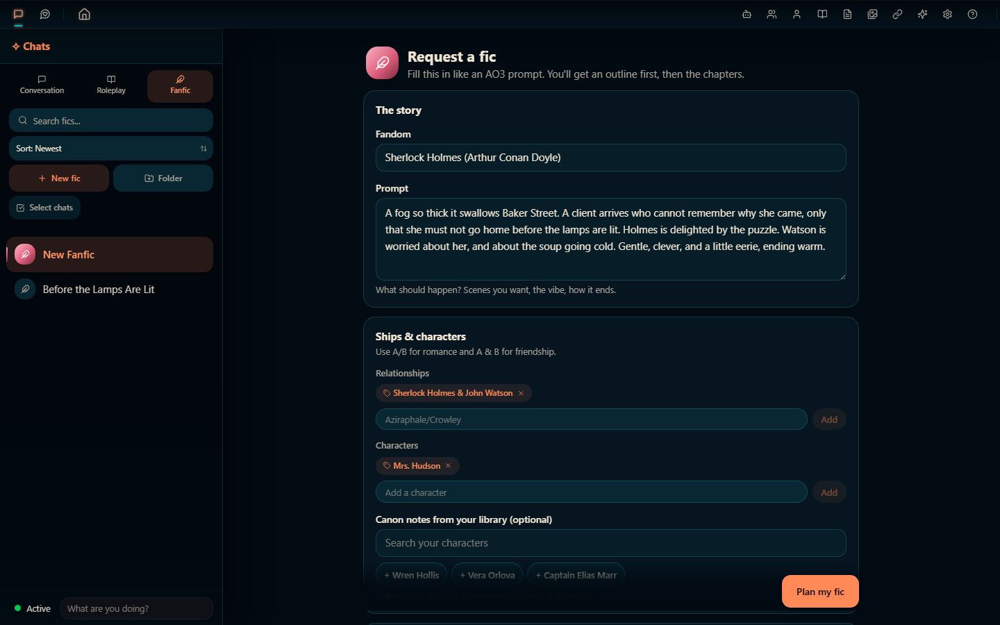
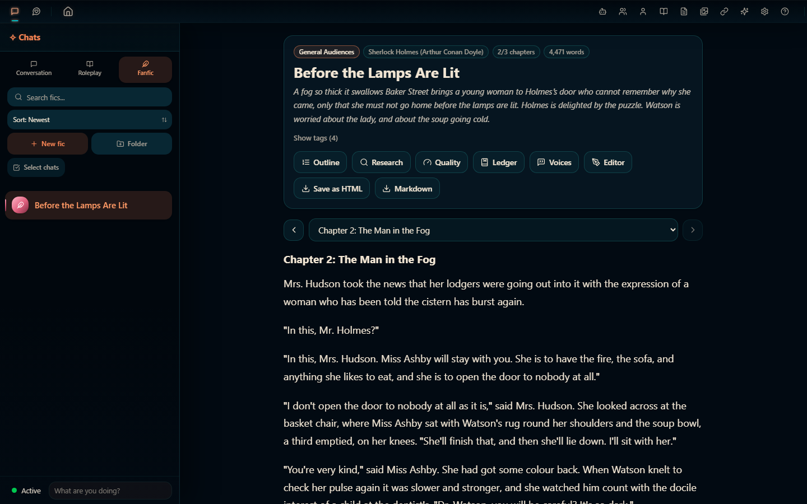
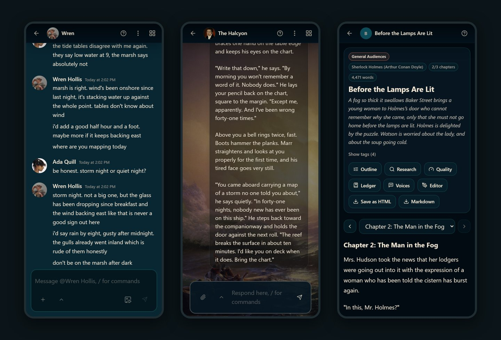

# De-Koi

**Local-first AI chat, roleplay, and fanfic.** Run it on your desktop, on a Raspberry Pi, or on a server you own, and
open it from your phone. Bring your own model: a hosted API, your Claude or ChatGPT subscription, or a local model
De-Koi downloads and runs for you.



> [!IMPORTANT]
> De-Koi is an unofficial modified fork of
> [Marinara Engine](https://github.com/Pasta-Devs/Marinara-Engine).
> It is a separate project and is not an official Marinara Engine release,
> support channel, or distribution.
>
> De-Koi is not sponsored by, endorsed by, or released on behalf of Marinara
> Engine, Spicy Marinara, Pasta Devs, or the Marinara Engine project.
>
> De-Koi is licensed under the GNU Affero General Public License version 3.
> See [`LICENSE.txt`](./LICENSE.txt) for the full license and
> [`NOTICE.md`](./NOTICE.md) for fork, attribution, source, and other notices.
>
> If you receive or use a De-Koi binary, installer, Docker image, APK,
> pre-release build, or hosted network service, you should also have access to
> the exact corresponding source code for that version.

## Three ways to write with AI

### Conversation

Text characters the way you text friends. One-on-one or group chats, characters with statuses and schedules who can
message you first, per-character bubble styles, and slash commands.



### Roleplay

Scene-based roleplay with personas, character portraits and sprites, backgrounds, choices, and lorebooks. For long
campaigns, the Continuity Director plans arcs and beats you approve, and memory recall keeps earlier events in view.

### Fanfic

Request a fic like an AO3 prompt: fandom, ships, rating, tropes, point of view, length. De-Koi can look up the canon
online first, shows you an outline to edit or skip, then writes it chapter by chapter.

| Request it                                                                                                       | Read it                                                                                                            |
| ---------------------------------------------------------------------------------------------------------------- | ------------------------------------------------------------------------------------------------------------------ |
|  |  |

Then make it better without starting over: check a chapter for continuity slips and fix them in one tap, keep a story
ledger of who knows what, check that characters sound like themselves, run an editor pass that rewrites only weak
scenes, let the outline re-plan itself after each chapter, rewrite any passage you select, listen to it read aloud,
and save it as HTML or Markdown.

### And around all three

- **Any model.** OpenAI, Anthropic, Google Gemini and Vertex AI, Mistral, Cohere, OpenRouter, NanoGPT, xAI, any
  OpenAI-compatible endpoint, your Claude or ChatGPT subscription, or the built-in local model.
- **Your library.** Characters (imports SillyTavern cards), personas, lorebooks, prompt presets, regex scripts, and a
  gallery, all stored on your machine.
- **Deki-senpai.** A built-in assistant that answers questions about the app and can draft or tidy your library, with
  a preview before anything changes.
- **Voice and images.** Text-to-speech (ElevenLabs, OpenAI, or a local voice) and image generation.
- **Phone-ready.** Host it on a Pi or server and the same chats open on your phone and your PC.



## Get De-Koi

De-Koi is in **beta**. Back up before you install or update ([how](docs/install.md#before-you-update-or-reinstall-back-up)).

| Platform     | Download                                                                                                                   |
| ------------ | -------------------------------------------------------------------------------------------------------------------------- |
| Windows      | `De-Koi_<version>_windows-x64-setup.exe` from the [latest release](https://github.com/The-Koi-Pond/De-Koi/releases/latest) |
| Linux        | `.AppImage` or `.deb` from the same release                                                                                |
| Android      | the signed `.apk` from the same release                                                                                    |
| Raspberry Pi | prebuilt images: [Pi guide](docs/pi.md), or [without Docker](docs/pi-bare-metal.md)                                        |
| VPS / server | the [VDS / VPS guide](docs/vds.md) (web app for your phone and PC, behind HTTPS or a private network)                      |
| macOS        | no build yet; [run from source](#run-from-source)                                                                          |

Step-by-step install, checksum and uninstall help: [Install De-Koi](docs/install.md). Windows and Linux builds update
themselves once you say yes, and every update is signature-checked. On Android, install the new APK over the old one.
The Windows installer isn't Authenticode-signed yet, so SmartScreen warns the first time you install.

## Every feature

This list is generated from the app's in-app Discover guide, so it matches what the app ships. Open a section to see
it.

<!-- features:start (generated from the Discover registry by `pnpm docs:readme-features`; do not edit) -->

<details>
<summary><b>Chat modes</b> (9)</summary>

- **Conversation Mode**: Text characters the way you text friends: one-on-one or group chats, per-character bubble styles, statuses and schedules, characters who can message you first, slash commands, editing a text you sent and resending it (your old wording and its reply stay one tap away), translation of messages and drafts (you can cancel it), and guards against repetitive replies.
- **Message Reactions**: React to a character's text with a quick tapback (❤️ 😂 😮 😢 👍 👎) from the message's action bar, and characters can react to yours too. Reactions show under the message, and the character sees how its texts landed. Tap your reaction again to take it back.
- **Roleplay Mode**: Long-form story roleplay in the narration style you choose. It steers the AI away from repeating itself, gently corrects replies that act for your character (with a note showing what changed and a way to restore the original), and can translate messages and drafts. Includes character narration, controls to start and end scenes, sprites, backgrounds, lorebooks, trackers, and optional agents.
- **Fanfic Mode**: Request a fanfic like an AO3 prompt: fandom, ships, rating, warnings, tropes, point of view, and length, plus character cards and lorebooks from your library as canon notes. De-Koi can look up the canon online first, shows an outline you can edit or skip, then writes it chapter by chapter. Steer or rewrite chapters with notes, listen to them read aloud, and run quality, continuity, and in-character checks with one-tap fixes. A story ledger of who knows what and per-character voice sheets with real canon lines keep long fics consistent. An editor pass rewrites only the weak scenes, the outline re-plans itself after each chapter, you can rewrite any passage you select and pick from versions, and local models can ban phrases outright. Save it as HTML or Markdown.
- **Message Search**: Find anything you or a character said in any Conversation or Roleplay chat. Type in the sidebar search, switch to Messages, and tap a result to open that chat right at the message, even if it was hundreds of messages ago.
- **Roleplay workflow profiles**: Choose a setup for your roleplay: Simple Roleplay for a short or casual chat, Long-Running Story for a campaign across scenes or sessions, Cinematic Roleplay when visuals matter, or Local Helpers once your local model is ready. Before applying one, you see what it adds and how many extra model calls it makes. Your main writing connection stays as it is.
- **Roleplay Context Panels**: Use roleplay helper panels for author notes, context injections, active world info, sprites, and HUD state.
- **Roleplay Continuity Director**: Plans a long roleplay as a story: arcs, open threads, and upcoming beats you can see. Apply and confirm the Long-Running Story profile to turn it on. If that newly turns on the Director and there's no saved plan yet, it makes one extra planning call to your model right away; after that it makes one more in the background every 10 replies, without holding up the chat. New beats stay proposed until you approve them, and a badge shows when some are waiting. The Director only plans: your writer model still writes, and your character's choices stay yours.
- **Character Web Research**: Let characters look things up on the public web when they need current facts. The research can stay in the background or show up as in-character narration; De-Koi asks your permission first and lists the sources, collapsed, at the end.

</details>

<details>
<summary><b>Getting started</b> (3)</summary>

- **Connections**: Configure and organize model providers, API keys, local endpoints, managed Local Model setup, subscription image generation, voice providers, separate chat, agent, and Illustrator defaults, and per-chat vision connections for image input.
- **Imports**: Bring in characters, personas, lorebooks, presets, SillyTavern data, and Marinara profile exports.
- **Backups And Profile Export**: Create managed backups, download backup files, export a native profile JSON, and restore data through profile import.

</details>

<details>
<summary><b>Library</b> (9)</summary>

- **Characters**: Create, import, group, and edit character cards, with version history and per-character memories. Imported cards get a quick check for garbled text, name labels in greetings, old Claude 2 scaffolding and stock AI phrases, each with a previewed Fix it. Export Character Card V3 JSON or CHARX packages with avatar, banner, and sprites, or De-Koi's own format with cleaned-up memories if you want them. Choose whether a character remembers across chats, generate missing card fields, and set a public profile and music taste (shown as what they're listening to, with songs you can play). When a card is thin, De-Koi quietly infers a few tendencies from how the character actually behaves in chats; what you wrote always wins.
- **Improved Opening Alternatives**: Generate one reviewable opening alternative that preserves the original first message, user agency, card premise, formatting, and macros until you explicitly save it as an alternate greeting.
- **Conversation Avatar**: Override a character's avatar in Conversation mode — show an emoji, one of its sprites, a gallery image, or hide it entirely.
- **Personas**: Manage who you play as, including persona descriptions, avatars, and groups that chats can use for context.
- **Lorebooks**: Store, organize, test, and inspect world info, setting details, rules, backstory, and keyword-triggered context assigned to chats, characters, or personas.
- **Prompt Presets**: Control how prompts are built for different chat styles: sections, variables, generation settings, and where each piece of context comes from.
- **Bot Browser**: Browse downloadable character cards and related community resources from inside De-Koi.
- **Character Gallery**: Store and review character-specific images separately from chat gallery images and generated scene attachments.
- **Gallery**: Keep a profile-wide image library organized into folders, reusable across the whole app and independent of any chat.

</details>

<details>
<summary><b>Agents</b> (2)</summary>

- **Agents**: Optional helpers that run alongside your chats: track the state of the world, review or write lorebooks, create images, or run your own custom behavior. Turn each one on or off everywhere, rename it, edit its credits, and import or export it.
- **Trackers**: Keep track of the world, your persona, characters, quests, or anything custom. Trackers show that state alongside your Roleplay chats.

</details>

<details>
<summary><b>Media</b> (4)</summary>

- **Text-to-Speech**: Configure voice providers and let chats, narration, or characters speak with assigned voices.
- **Voice Calls And Voice Input**: Call a Conversation character: talk, and they answer out loud in their Text to Speech voice, hands-free, with every turn kept in the chat as texts. The mic button and calls can transcribe with your Text to Speech provider (OpenAI Whisper or ElevenLabs Scribe) instead of the browser. Needs microphone access, so hosted installs need an https:// address.
- **Image Generation**: Set up and test image connections, including image generation with a Codex Subscription, plus style profiles for selfies, sprites, backgrounds, tracker portraits, and scene illustrations.
- **Music Player**: Turn on the Music Player module and it picks music that fits the roleplay scene, with a Fresh Pick button for a new track. Each character's Music Taste adds songs to their profile that you can play yourself.

</details>

<details>
<summary><b>Settings</b> (10)</summary>

- **Settings**: Global controls for appearance, chat behavior, sound preferences, imports, themes, extensions, backups, updates, and advanced runtime options.
- **Privacy And Data Controls**: Review how De-Koi stores and sends data, export or back up your library, erase selected categories, or perform a typed-confirmation complete wipe of De-Koi-managed data.
- **Health And Diagnostics**: Check that setup is complete and everything is working: the local model, your providers, storage, and recent errors. Copy a troubleshooting report with private details removed.
- **Notification Sounds**: Choose the Frog default, the Legacy ding, or a small custom audio file for local chat alerts.
- **Phone Notifications**: On a hosted De-Koi (like a Raspberry Pi), get a notification on your phone or computer when a character texts you first or a reply finishes while De-Koi is closed. Characters can text first even with no tab open. Needs De-Koi on an https:// address. Message text is never included.
- **Modules**: Enable or disable bundled modules like ME Notes and Music Player without importing custom extension files.
- **Extensions**: Install CSS, JavaScript, or package manifest extensions, then enable, disable, and manage local behavior without editing core source.
- **Extension Device Access**: Before an extension runs, check that it's compatible and see what it asks for, then turn on its CSS or trusted page-level JavaScript on this device and this De-Koi install only.
- **Themes, Fonts, And Backgrounds**: Customize visual themes, custom CSS themes, fonts, chat backgrounds, gradient styling, and mode-specific appearance.
- **Custom Font Upload**: Install your own fonts (TTF, OTF, WOFF, or WOFF2) from Settings. On a self-hosted server you upload the file; in the desktop app you can also open the fonts folder.

</details>

<details>
<summary><b>Advanced</b> (12)</summary>

- **Regex Scripts**: Manage SillyTavern-style find/replace scripts that change what you see, what the AI reads, or both.
- **Slash Commands**: Type / in the chat input to see command autocomplete for actions such as help, dice rolls, reminders, guided replies, response amendments, private scene illustration guidance, and impersonation.
- **Discord Mirror**: Mirror chat messages into a Discord channel through a webhook while keeping character names and narration labels readable.
- **Inline Model Reasoning**: Optionally show reasoning returned by the model in a separate collapsible panel beneath character replies while keeping final answers primary.
- **Recommended Generation Profiles**: Let De-Koi choose stable generation and prompt-budget settings for each chat mode and model, or switch to explicit Custom values.
- **Prompt Overrides**: Customize selected prompt templates for specialized generation behavior without editing core source.
- **Quick Replies**: Optional input actions for posting without generation, guiding a reply, impersonating a character, or saving custom slash-command buttons from mode input toolbars.
- **Chat Settings Presets**: Save, apply, import, export, rename, and delete reusable chat settings bundles for repeated chat setups.
- **Prompt Inspector**: Inspect advanced prompt details including budget estimates, context attribution, section token counts, warnings, assembled prompt sections, roles, variables, generation parameters, and replay details before or after generation.
- **Swipes And Rerolls**: Move between alternate generations, regenerate replies, amend the latest response with a targeted instruction, and optionally use your draft as guidance for the next retry.
- **Message Moment Actions**: Start from a chat message and route it to continuity actions, including remembering the beat in chat summaries, or drafting lorebook entries. Use the brain action for Remember this, the adjacent branch action for branching, and the paintbrush to illustrate that exact message.
- **Chat Continuity Overview**: See what your characters will remember, and manually add your own memories: chat-local ones in the Memory Console, or character-wide ones in the Character Editor. "Who knows this?" decides which characters, personas, or groups may use a memory in Roleplay; facts about the world never count as a character knowing them. In Roleplay, De-Koi also groups the story into episodes and four-episode arcs in the background, each linked to its source, which you can inspect, edit, regenerate, pin, or retry, or build for a story you already have. De-Koi automatically rejects low-value memories and quietly combines or removes stored ones in the background (automatic memory hygiene); pinned, edited, and hand-written memories follow the same rules, and you can undo the latest cleanup. Repair from chat history rebuilds automatic memories without AI. When you delete a chat, choose whether memories learned only from it go too. It keeps speaker-labeled exchanges, and matching memories are ranked by relevance next to summaries, world info, and trackers.

</details>

<details>
<summary><b>Help</b> (5)</summary>

- **Help Hub**: A central Help surface for diagnostics, bug reports, onboarding replay, shortcut reference, and app version details.
- **Show Me Around**: Replay the short five-step orientation tour for Chats, workspace navigation, and the main workspace. Use the readiness checklist to resume setup without changing your library or settings.
- **Report A Bug**: Copy a short support report and open the configured GitHub issue form.
- **Deki-senpai**: Deki-senpai, De-Koi's built-in assistant. Ask about the app or its code, have it draft characters and other library items, or let it edit and tidy your library. Every change waits for your approval, with a preview that lists everything a delete would also remove or change. Watch it work step by step and stop it at any time, review the memories it can see, and come back to its sessions later, separate from your chats.
- **Customization Safe Mode**: Recover from a broken theme or extension without loading customizations by opening De-Koi with ?safe-mode=customizations.

</details>

<!-- features:end -->

## Run from source

You need Node.js, pnpm, the Rust stable toolchain, and the
[Tauri prerequisites](https://v2.tauri.app/start/prerequisites/) for your operating system. Then:

```sh
pnpm install
pnpm tauri dev
```

That opens the desktop app. `pnpm dev` runs only the web interface (some desktop-only features are unavailable there),
and `pnpm tauri build` builds an installer.

<details>
<summary><b>Arch-family Linux setup and WebKit troubleshooting</b></summary>

On CachyOS, Arch, Manjaro, EndeavourOS, and other Arch-family systems:

```sh
sudo pacman -Syu
sudo pacman -S --needed git nodejs pnpm rustup webkit2gtk-4.1 base-devel curl wget file openssl appmenu-gtk-module libappindicator-gtk3 librsvg xdotool
rustup default stable
```

If the Linux window opens blank, crashes, or has WebKit/GPU rendering trouble, disable WebKit's DMA-BUF renderer:

```sh
WEBKIT_DISABLE_DMABUF_RENDERER=1 pnpm tauri dev
```

On Wayland, also try forcing the GTK backend to X11 for that run:

```sh
GDK_BACKEND=x11 WEBKIT_DISABLE_DMABUF_RENDERER=1 pnpm tauri dev
```

As a browser-only fallback, run the web interface and the Rust runtime in two terminals, then open the Vite URL in
Firefox:

```sh
pnpm dev
cargo run --manifest-path src-tauri/Cargo.toml --bin de-koi-server
```

The web interface opens at `http://127.0.0.1:1420/`. Set Settings > Advanced > Remote Runtime URL to
`http://127.0.0.1:8787`.

</details>

<details>
<summary><b>Track <code>main</code> on Windows</b></summary>

```powershell
.\start-main.cmd
```

This launcher fetches `origin/main`, rebuilds when the checkout changed, and starts the desktop app. See
[Source Main-Channel Launcher](docs/source-main-launcher.md) for shortcut setup, options, and risk notes.

</details>

## Self-hosting

<details>
<summary><b>Optional remote runtime</b></summary>

De-Koi includes an optional Rust API runtime for advanced local or self-hosted setups. It does not serve the
interface on its own.

```sh
cargo run --manifest-path src-tauri/Cargo.toml --bin de-koi-server
```

It listens on `http://127.0.0.1:8787` by default and refuses non-loopback clients unless you configure access control
(basic auth, an IP allowlist, or another trusted private-network opt-in). See the
[run and build guide](./docs/developer/run-build.html) for Docker, CORS, CSRF, proxy, and data-directory details.

</details>

<details>
<summary><b>VDS / VPS Pre-Alpha Web Shell</b></summary>

VDS/VPS users can run the same web-app plus Rust-runtime container pair on a normal self-hosted server: one trusted
personal instance you open from your phone and PC against the same data. Start with the
[VDS fast install and update guide](docs/vds.md). It covers multi-arch pre-alpha images, reverse-proxy HTTPS,
Tailscale/VPN use, auth, and why port `8787` should stay private behind the web container.

</details>

<details>
<summary><b>Raspberry Pi</b></summary>

Use the prebuilt Pi container images instead of building on the Pi. The shortest path is the
[Pi fast install and update guide](docs/pi.md). For Raspberry Pi OS Lite without Docker, use the
[bare-metal Pi guide](docs/pi-bare-metal.md).

Start or update a trusted home LAN or Tailscale Pi from the repository root:

```sh
sh scripts/pi-update.sh --trusted-lan
```

Or start the hardened default web app and update it later:

```sh
docker compose -f docker-compose.pi.yml up -d
docker compose -f docker-compose.pi.yml pull
docker compose -f docker-compose.pi.yml up -d
curl -I http://127.0.0.1:7860/
```

Only the web container is exposed, on port `7860`; the Rust runtime stays private on the Docker network behind nginx.

</details>

<details>
<summary><b>Local network prompts</b></summary>

Some operating systems ask whether De-Koi can reach devices on your local network. De-Koi uses that only for opt-in
local workflows: local model servers, image tools, OAuth callbacks, Home Assistant, or a self-hosted runtime. If you
use none of those, you can deny the prompt and still use ordinary hosted providers.

</details>

## For contributors

Developer docs are static HTML under [`docs/developer`](./docs/developer/index.html); `pnpm docs:dev` serves them at
`http://127.0.0.1:4174/`. Good starting points: [architecture](./docs/developer/architecture.html),
[module ownership](./docs/developer/modules.html), [extensions](./docs/developer/extensions.html), and the
[storage schema](./docs/database-schema.md).

Before a pull request, run `pnpm check` (types, lint, tests, architecture and docs checks). Rust changes also need
`cargo fmt` and `cargo clippy`. When you add or change a feature, update the Discover registry in
`src/features/shell/discovery/discovery-entries.json` and run `pnpm docs:readme-features` so this page stays current.
The screenshots above come from `pnpm docs:readme-screenshots`; see [screenshot guidance](docs/screenshot-guidance.md).
